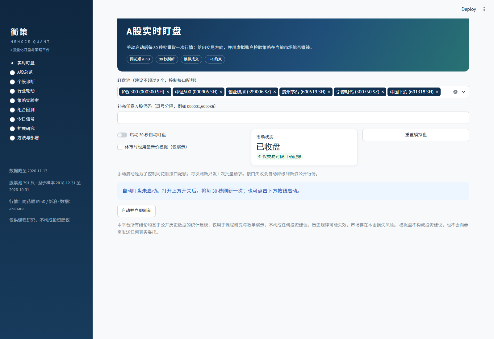
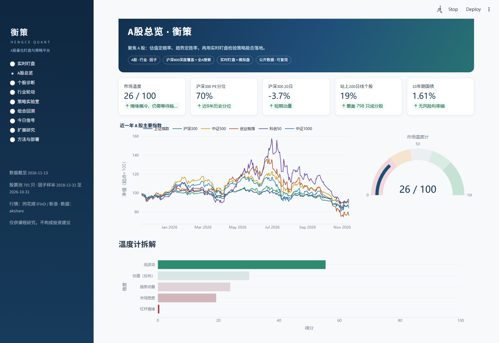
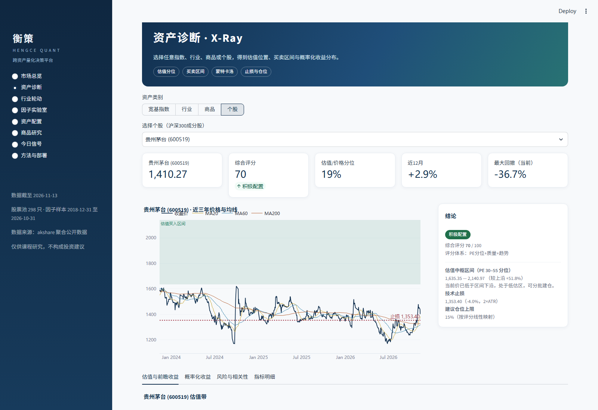
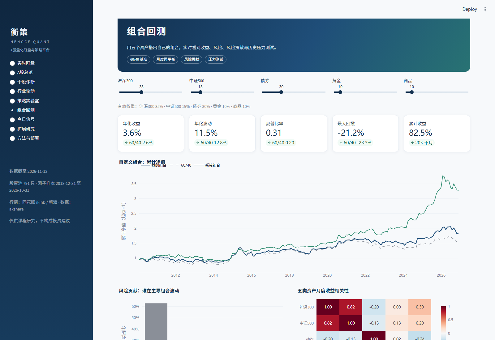
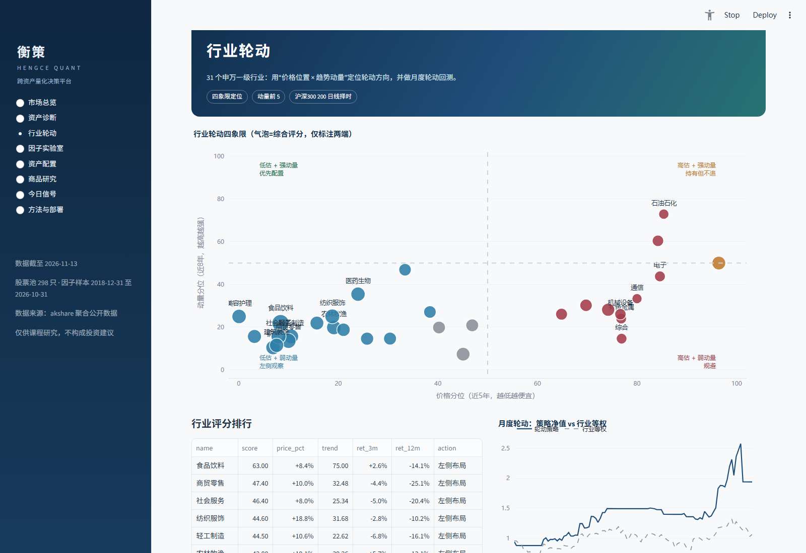
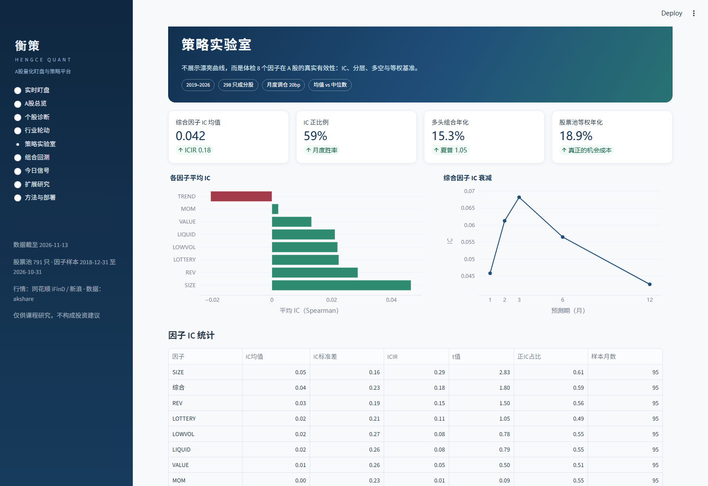
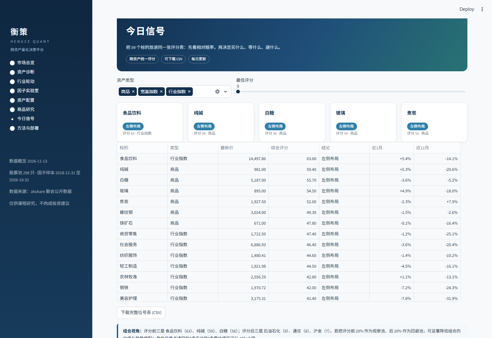

# 衡策 HENGCE · A股量化盯盘与策略平台

> 一个市场，做深做透：**盘中盯方向，盘后用策略验证它到底能不能赚钱。**

聚焦 A 股二级市场的量化平台：实时盯盘、估值与趋势诊断、行业轮动、因子体检、组合回测。使用公开日频/月度数据，不依赖高频行情；既可本地运行，也可部署到云端分享。

## 界面预览

| 实时盯盘 | A股总览 |
|---|---|
|  |  |

| 个股诊断 | 组合回测 |
|---|---|
|  |  |

| 行业轮动 | 策略实验室 |
|---|---|
|  |  |

| 组合回测 | 今日信号 |
|---|---|
|  |  |

## 功能

| 页面 | 内容 |
|---|---|
| 实时盯盘 | 手动开启，每 30 秒批量取一次行情；给出买入/加仓/观望/减仓/回避，并用 100 万虚拟账户按 T+1 规则检验策略 |
| A股总览 | 市场温度、沪深300 PE 分位、股债性价比、宏观状态、A股主要指数、新闻情绪、今日机会/风险 |
| 新闻情绪 | 东方财富快讯→利好/利空词表→0–100 情绪分、行业新闻热度、个股相关新闻 |
| 个股诊断 | 估值分位、估值中枢区间、2×ATR 止损、蒙特卡洛 12 个月收益分布 |
| 行业轮动 | 31 个申万一级行业的“价格位置 × 动量”四象限；动量前 5 + 200 日线择时回测 |
| 策略实验室 | 791 只成分股的因子 IC/分层；FF3、FF5、中国四因子收益；自定义因子权重回测 |
| 组合回测 | 五类资产自定义权重，风险贡献、相关性与 2015/2018/2020/2022/2026 压力测试 |
| 财务指标 | 单只股票的 ROE、毛利率、净利率、负债率、成长与估值；同池筛选 |
| 今日信号 | A股宽基+行业的统一评分表，含评分前 5 操作清单，可导出 CSV |
| 扩展研究 | 跨资产配置与商品周期，作为 A 股策略的环境参考，不属于主线 |

核心方法不是“预测点位”，而是把**赔率（估值/价格位置）**与**胜率（趋势/动量/低波）**分开打分，再映射为六种动作；辅以历史条件分布与蒙特卡洛给出区间。

## 数据覆盖

- **全 A 股 5,579 只**代码与名称：实时盯盘可输入任意 6 位代码；
- **791 只沪深300/中证500成分股**：2018 年以来的前复权日线、PE/PB/市值与财务指标，用于因子与个股诊断；
- **31 个申万一级行业**：1999 年以来日线，用于轮动；
- 商品、债券、宏观作为扩展研究，不占用主线。

全部通过 [akshare](https://github.com/akfamily/akshare) 聚合公开数据；实时行情优先使用同花顺 iFinD，失败时自动降级到新浪财经。

## 快速开始

```bash
pip install -r requirements.txt
streamlit run app.py
```

打开 <http://localhost:8501>。仓库包含离线数据快照，**无需联网、无需数据库**即可运行。

刷新数据（需要联网）：

```bash
pip install -r requirements-dev.txt
python scripts/refresh_all.py     # 抓取 → 压缩 → 重建快照 → 自检
```

## 实时盯盘与同花顺 iFinD

实时页是**手动开启**的：开关打开后每 30 秒刷新一次，每次只发 1 次批量行情请求，避免消耗接口配额；关闭后不再请求。

同花顺 iFinD 需要本机安装终端和 `iFinDPy`。账号只放在本地未入库的 `.streamlit/secrets.toml`：

```toml
THS_ACCOUNT = "your_account"
THS_PASSWORD = "your_password"
```

- 优先使用 iFinD 实时行情；
- 未配置、登录失败或额度不足时自动降级到新浪公开行情；
- 模拟盘只做本地记账，**不会向券商发送任何真实委托**；
- 不要把 `secrets.toml` 提交到 Git（`.gitignore` 已忽略）；如账号曾出现在聊天/日志中，建议尽快改密。

## 运行速度

- 因子面板已预计算为 `data/derived/factor_panel.parquet`，策略实验室不再每次读取 791 个 CSV；
- scipy 只在用到风险平价/IC 时加载，首屏不导入；
- 离线数据已压缩为 Parquet，仓库约 120 MB，Streamlit Cloud 冷启动通常 30–60 秒，之后页面切换在 1–3 秒。

## 云端部署 / 分享


### 最短路径（约 5 分钟）

```bash
cd D:/数学建模/quant-platform
git init && git add . && git commit -m "HENGCE A-share quant platform"
git branch -M main
git remote add origin https://github.com/<你的用户名>/<仓库名>.git
git push -u origin main
```

然后在 <https://share.streamlit.io> 选择该仓库、分支 `main`、入口 `app.py`，点 Deploy。生成的
`https://<app-name>.streamlit.app` 就是可以发给别人的链接。

> `.streamlit/secrets.toml` 已被 `.gitignore` 忽略，不会上传；云端实时盯盘如需 iFinD，请在
> Streamlit Cloud 的 Secrets 面板里单独填写。

### 方式一：Streamlit Community Cloud（推荐，免费）

1. 在 GitHub 新建仓库，将本目录推送到仓库根目录（`app.py` 必须在根目录）。
2. 打开 <https://share.streamlit.io>，选择 **New app**，绑定仓库与分支。
3. Main file path 填 `app.py`，点击 **Deploy**。
4. 构建完成后获得 `https://<app-name>.streamlit.app` 链接，可直接分享。

> 实时盯盘在云端需要把 iFinD 凭据写入 Streamlit Secrets；不配置则自动使用新浪行情。

### 方式二：Hugging Face Spaces

1. 新建 Space，SDK 选择 **Streamlit**。
2. 上传本目录全部文件（或连接 GitHub 仓库）。
3. 参考 `deploy/README_HF.md` 的 frontmatter 配置。

### 方式三：Docker / 任意云主机

```bash
docker build -t hengce .
docker run -p 8501:8501 hengce
```

### 方式四：Render / Railway

仓库已附带 `render.yaml` 与 `Procfile`，导入仓库即可自动读取启动命令。

### 方式五：局域网临时分享

```bash
streamlit run app.py --server.address=0.0.0.0 --server.port=8501
```

同一局域网内访问 `http://<你的内网IP>:8501`。

## 目录结构

```
quant-platform/
├─ app.py                  # Streamlit 入口（11 个页面）
├─ core/
│  ├─ config.py            # 资产元数据、配色、免责声明
│  ├─ data.py              # 数据访问层（CSV/Parquet 缓存）
│  ├─ indicators.py        # 绩效、估值、技术、宏观状态指标
│  ├─ factors.py           # 因子构造、IC、分层、多空回测
│  ├─ allocation.py        # 债券合成、风险平价、组合与压力测试
│  ├─ commodities.py       # 商品季节性、库存周期（扩展）
│  ├─ live.py              # 同花顺 iFinD / 新浪实时行情
│  ├─ news.py              # 财经快讯 → 新闻情绪指标
│  └─ signals.py           # 统一评分、买入区间、蒙特卡洛
├─ scripts/
│  ├─ fetch_data.py        # 公开数据抓取（沪深800 + 全A列表）
│  ├─ build_snapshots.py   # 预计算 → data/derived/
│  ├─ compact_data.py      # CSV → Parquet
│  ├─ refresh_all.py       # 一键刷新
│  └─ self_check.py        # 数据与指标自检
├─ data/                   # 离线数据快照
├─ assets/screenshots/     # 界面截图
├─ deploy/                 # 云端部署补充说明
├─ requirements.txt        # 运行依赖（不含 akshare）
└─ Dockerfile
```

## 已知局限

- 深度历史池为**当前**沪深300/中证500成分，存在幸存者偏差；
- 全 A 列表用于搜索/盯盘，不在深度池的股票只有盘中动量信号，没有估值与长周期趋势；
- 商品使用主力连续合约，换月点存在跳空；
- 债券收益为久期近似（D≈7.5），未计凸性与信用利差；
- 实时模拟盘不含滑点、手续费与涨跌停无法成交的情况，实盘表现会更差；
- 所有结论均为历史统计，不构成投资建议。

## 免责声明

本项目仅用于金融工程课程作业与研究演示。历史规律可能失效，市场存在本金损失风险；任何评分、区间、信号与模拟成交均不构成投资建议。
